# SURIYAPRAKASH R M

  

### AI • SOFTWARE ENGINEERING • CLOUD • PRODUCTS

**Building intelligent systems, scalable software and real-world products.**

  
  &nbsp;
  
  &nbsp;
  
  &nbsp;
  

  <code>Curiosity → Experiment → Build → Break → Learn → Ship</code>

---

## WHO I AM

<table>
<tr>
<td width="58%" valign="top">

### Building by learning

I'm a B.Tech Artificial Intelligence & Data Science student who enjoys building things at the intersection of **AI, software engineering, data, cloud infrastructure and product development**.

I learn best by building.

If a technology catches my attention, I usually end up experimenting with it, building a prototype, breaking it, figuring out why it broke, and trying again.

I don't want to just learn how technology works.

**I want to build with it.**

</td>

<td width="42%" valign="top">

### Areas I Work In

- **Artificial Intelligence & Machine Learning**
- **Software Engineering & Full-Stack Development**
- **Cloud & DevOps**
- **Data & Intelligent Systems**
- **Startups, SaaS & Product Development**
- **Emerging Technologies & Experimental Ideas**

</td>
</tr>
</table>

---

## HOW I BUILD

### IDEA → EXPLORE → EXPERIMENT → BUILD → BREAK → DEBUG → LEARN → SHIP

I don't follow a fixed technology stack.

**I follow interesting problems.**

Most of my projects start with a simple question:

> What happens if I try this?

---

## CURRENTLY BUILDING

<table>
<tr>

<td width="33%" valign="top">

### STATUTEK

**Startup • Business Services • Web**

Website for STATUTEK, a startup offering company registration, GST, trademark and Startup India support plus web, SaaS and branding work.

 

[Repository](https://github.com/suriyaprakash-25/STATUTEK) · [Live Project](https://statutek.vercel.app/)

</td>

<td width="33%" valign="top">

### DRIVEPORTZ (DIGITAL TWIN)

**Marketplace • Payments • Full Stack**

A car ownership and garage marketplace: every car gets a "vehicle passport" with service history, health score and resale estimate, and owners book and pay garages online.

 

[Repository](https://github.com/suriyaprakash-25/Digital-Twin) · [Live Project](https://www.driveportz.com/)

</td>

<td width="33%" valign="top">

### SEPSISSENSE

**Machine Learning • Healthcare AI**

Hourly sepsis early warning for ICU patients, trained on 40,336 PhysioNet patients (ROC-AUC 0.86 on held-out patients), with SHAP explanations, a clinician dashboard and a patient portal.

 

[Repository](https://github.com/suriyaprakash-25/SepsisSense)

</td>

</tr>

<tr>

<td width="33%" valign="top">

### CAMPUSCODE

**Full-Stack Development • Platform Architecture**

A coding and aptitude practice platform concept designed around structured practice with dedicated experiences for administrators, teachers and students.

</td>

<td width="33%" valign="top">

### AI EXPERIMENTS

**LLMs • Intelligent Systems • Automation**

LLM and agent projects: an MCP storefront for AI shopping agents ([AgentShelf](https://github.com/suriyaprakash-25/AgentShelf)), a text-to-SQL analyst ([AskMetrics](https://github.com/suriyaprakash-25/AskMetrics)), a multi-agent counterfeit investigator ([CounterGuard AI](https://github.com/suriyaprakash-25/counterguard-ai)) and a story-to-comic generator ([Comic Book Generator](https://github.com/suriyaprakash-25/Comic-Book-Generator)).

</td>

<td width="33%" valign="top">

### THE LAB

**Experiments • Prototypes • Ideas**

A space for experiments, prototypes and ideas that exist mainly because I wanted to answer one question:

> What happens if I try this?

</td>

</tr>
</table>

---

## TECH UNIVERSE

<table>
<tr>

<td width="33%" valign="top">

### Languages

  
  
  
  
  
  

</td>

<td width="33%" valign="top">

### AI / ML

  
  
  
  
  

**Computer Vision**  
**Deep Learning**  
**Data Science**

</td>

<td width="33%" valign="top">

### Software Engineering

  
  
  
  

**REST APIs**  
**Full-Stack Development**  
**Backend Architecture**

</td>

</tr>

<tr>

<td width="33%" valign="top">

### Data & Databases

  
  
  
  
  
  

</td>

<td width="33%" valign="top">

### Cloud & DevOps

  
  
  
  
  
  

**CI/CD • Deployment • Automation**

</td>

<td width="33%" valign="top">

### Tools

  
  
  
  
  

</td>

</tr>
</table>

---

## FEATURED PROJECTS

Every repository below has a README covering what it does, its architecture, how it works and how to run it.

<table>
<tr>

<td width="50%" valign="top">

### SEPSISSENSE

**Explainable Sepsis Early Warning for the ICU**

Estimates every hour an ICU patient's risk of sepsis in the next six hours and explains why. Trained on all 40,336 PhysioNet 2019 patients on a laptop GPU with a utility-weighted XGBoost + LightGBM ensemble, calibrated, with SHAP explanations. ROC-AUC 0.86 on 8,068 held-out patients; clinician dashboard and patient portal.

`Machine Learning` `XGBoost` `LightGBM` `SHAP` `FastAPI` `React`

[Repository](https://github.com/suriyaprakash-25/SepsisSense)

</td>

<td width="50%" valign="top">

### DRIVEPORTZ (DIGITAL TWIN)

**Car Ownership & Garage Marketplace**

Gives every car a "vehicle passport": service history, health score, resale estimate and ownership transfer. Owners book garages and pay online; garages and admins handle GST invoices, earnings, settlements and disputes.

`Node.js` `Express` `MongoDB` `React` `Cashfree` `CI`

[Repository](https://github.com/suriyaprakash-25/Digital-Twin) · [Live Project](https://www.driveportz.com/)

</td>

</tr>
<tr>

<td width="50%" valign="top">

### AGENTSHELF

**Storefront for AI Shopping Agents · PayPal AI Hackathon**

Small sellers turn WhatsApp photos into listings in an MCP storefront that AI shopping agents can search and quote from. Checkout uses PayPal Orders v2 with a human approving every payment; webhooks, tracking, refunds and invoices run through a job worker.

`MCP` `FastAPI` `PostgreSQL` `PayPal` `React` `Docker`

[Repository](https://github.com/suriyaprakash-25/AgentShelf) · [Live Demo](https://agentshelf-frontend.vercel.app)

</td>

<td width="50%" valign="top">

### MEDFLOW GUARDIAN

**Patient-Controlled Medical Records**

Hospitals can read a record only within the patient's current consent, enforced centrally by the backend. Time-boxed cross-hospital access, malware scanning of uploads, FHIR R4 import/export, MFA/OIDC login and full audit logs, with separate patient, doctor and admin portals.

`FastAPI` `PostgreSQL` `FHIR` `OIDC` `React` `Render`

[Repository](https://github.com/suriyaprakash-25/medflow-guardian)

</td>

</tr>
<tr>

<td width="50%" valign="top">

### REDROB RANKER

**Candidate Ranking Pipeline · Redrob Hackathon**

Ranks the top 100 of 100,000 candidates for a job description: fake-profile detection, structured job-fit scoring, TF-IDF/SVD semantic matching, claimed-vs-tested skill checks and fact-based reasoning. No LLM calls; about a minute on a CPU.

`Python` `scikit-learn` `TF-IDF` `Ranking` `Hugging Face`

[Repository](https://github.com/suriyaprakash-25/redrob-ranker) · [Demo](https://huggingface.co/spaces/Suriya-25/redrob-ranker)

</td>

<td width="50%" valign="top">

### BORESAKSHI

**Borewell Decision Support for Farmers · MSME Idea Hackathon 6.0**

Helps Tamil Nadu farmers decide where to drill. Rig operators log real drilling results, admins verify them, and a public accuracy ledger scores earlier predictions against those results, alongside an India-wide groundwater outlook.

`React` `Leaflet` `Express` `MongoDB` `FastAPI` `ML`

[Repository](https://github.com/suriyaprakash-25/BoreSakshi)

</td>

</tr>
<tr>

<td width="50%" valign="top">

### COUNTERGUARD AI

**Multi-Agent Counterfeit Listing Investigator**

A LangGraph team of agents investigates marketplace listings for counterfeit or grey-market risk and produces a 0–100 risk score with evidence and optional LLM reasoning. React dashboard, Chrome extension and graph/vector storage.

`LangGraph` `FastAPI` `Neo4j` `ChromaDB` `React` `Chrome Extension`

[Repository](https://github.com/suriyaprakash-25/counterguard-ai)

</td>

<td width="50%" valign="top">

### AUTOSHIELD EDGE AI

**In-Vehicle CAN Bus Intrusion Detection**

A virtual proof of concept for spotting attacks on a car's internal network: rules (ID allow-list, rate limits, message length) combined with frozen machine-learning models, demonstrated on six attack scenarios in a live React/D3 dashboard.

`Python` `scikit-learn` `Cybersecurity` `React` `D3`

[Repository](https://github.com/suriyaprakash-25/AutoShield-Edge-AI)

</td>

</tr>
<tr>

<td width="50%" valign="top">

### TRACKIT

**Multi-Store Inventory & Expiry Tracker**

Store admins manage stock, record sales and get expiry alerts and forecasts; customers track purchases, spending, budgets and items about to expire. Background jobs, caching, Docker/nginx and CI with unit, integration and browser tests.

`Next.js` `MongoDB` `NextAuth` `Redis` `Docker` `Playwright`

[Repository](https://github.com/suriyaprakash-25/Trackit) · [Live (earlier version)](https://inv-gdg.vercel.app/home)

</td>

<td width="50%" valign="top">

### STATUTEK

**Business Services Startup Website**

Website for STATUTEK, a startup offering company registration, GST, trademark and Startup India support plus web, SaaS and branding work. Five pages and a contact form that sends enquiries by email.

`React` `Vite` `Tailwind CSS` `EmailJS` `Vercel`

[Repository](https://github.com/suriyaprakash-25/STATUTEK) · [Live Project](https://statutek.vercel.app/)

</td>

</tr>
<tr>

<td width="50%" valign="top">

### ASKMETRICS

**Text-to-SQL Analytics Assistant**

Ask business questions in plain English; a local LLM writes SQL over a commerce database, every query passes read-only safety checks before it runs, and the UI picks a chart from the shape of the result.

`Ollama` `LLM` `SQLite` `FastAPI` `React`

[Repository](https://github.com/suriyaprakash-25/AskMetrics)

</td>

<td width="50%" valign="top">

### COMIC BOOK GENERATOR

**Story to Comic Page with Generative AI**

Turns a short story into a finished comic page: Llama 3 writes the panel script, FLUX.1 draws each panel with a consistent character description, and the page is laid out with speech bubbles.

`Llama 3` `FLUX.1` `Hugging Face` `FastAPI` `React` `Pillow`

[Repository](https://github.com/suriyaprakash-25/Comic-Book-Generator)

</td>

</tr>
</table>

### MORE PROJECTS

| Project | What it is | Stack |
|:---|:---|:---|
| [SIH · Metro Induction Planner](https://github.com/suriyaprakash-25/SIH) | Smart India Hackathon prototype for Kochi Metro: scores the readiness of 25 trainsets and assigns them to service, standby or maintenance, with what-if simulation and exports | React, Node.js, Firebase |
| [CrowdFundX](https://github.com/suriyaprakash-25/CrowdFundX) | Crowdfunding platform with campaigns, Razorpay donations and an admin moderation panel | MongoDB, Express, React, Node.js |
| [Recharge Web](https://github.com/suriyaprakash-25/recharge-web-frontend) ([backend](https://github.com/suriyaprakash-25/recharge-web-backend)) | Mobile recharge app with plan catalogue, simulated payments, history and admin analytics | React, Express, MongoDB, JWT |
| [MCP Social Uploader](https://github.com/suriyaprakash-25/mcp) | API and MCP tools that let AI agents upload videos to YouTube Shorts and Instagram Reels | FastAPI, MCP |
| [YESA](https://github.com/suriyaprakash-25/Yesa-2) ([first version](https://github.com/suriyaprakash-25/YESA)) | Scroll-animated site for a free incubator concept, with a working application form | React, TypeScript, Framer Motion |
| [Knowledge Nest](https://github.com/suriyaprakash-25/Knowledge_Nest) | Website for a Class 6–12 tuition centre with an email enquiry form | React, Tailwind CSS, EmailJS |
| [Anatomy Hub · CODEHOLICS](https://github.com/suriyaprakash-25/CODEHOLICS) | Team project for learning human anatomy with an embedded 3D model, doctor booking and a test-mode shop | HTML, CSS, JavaScript, Razorpay |
| [Portfolio](https://github.com/suriyaprakash-25/portfolio) | My personal site with case studies, two themes and live GitHub activity · [suriyaprakashrm.dev](https://www.suriyaprakashrm.dev/) | Next.js, React, TypeScript |

---

## THE LAB

<table>
<tr>

<td width="25%" valign="top">

### AI LAB

**Exploring**

- Machine Learning
- Generative AI
- LLM Applications
- Computer Vision
- Intelligent Automation

</td>

<td width="25%" valign="top">

### INFRASTRUCTURE LAB

**Exploring**

- Docker
- CI/CD
- Cloud Deployment
- Developer Automation
- Backend Infrastructure

</td>

<td width="25%" valign="top">

### ENGINEERING LAB

**Exploring**

- System Design
- APIs
- Backend Architecture
- Performance Experiments
- Developer Tools

</td>

<td width="25%" valign="top">

### PRODUCT LAB

**Exploring**

- SaaS Ideas
- Startup Experiments
- Business Automation
- Product Prototypes

</td>

</tr>
</table>

---

## ACHIEVEMENTS

<table>
<tr>

<td width="50%" valign="top">

### INDUSTRY & LEADERSHIP

**PayPal Mentorship Program**  
Selected for industry mentorship and exposure to real-world software engineering practices.

 

**FLY TO SINGAPORE 12.0 QUALIFIER — RYLA 54.0**  
Qualified through position-based selection for entrepreneurship, business planning, presentation and leadership performance.

</td>

<td width="50%" valign="top">

### HACKATHONS & COMPETITIONS

**Finalist — InnoHack, VIT University**  
Finalist in the InnoHack hackathon conducted by VIT University.

 

- **2nd Prize — Creatathon 2025**
- **2nd Prize — Freshathon 2025**
- **2nd Prize — Web Design Showdown 2025**

</td>

</tr>
</table>

---

## CURRENTLY LEARNING

<table>
<tr>

<td width="50%" valign="top">

### CORE ENGINEERING

- Advanced Data Structures & Algorithms
- System Design & Scalable Architecture
- Distributed Systems
- Backend Architecture

</td>

<td width="50%" valign="top">

### AI & INFRASTRUCTURE

- Machine Learning Engineering
- Generative AI & LLM Applications
- Cloud & DevOps
- Docker & CI/CD

</td>

</tr>
</table>

---

## GITHUB

&nbsp;

---

## CONTRIBUTION ACTIVITY

---

## CONNECT WITH ME

I'm always open to interesting conversations, collaborations, projects and opportunities.

 

&nbsp;

&nbsp;

&nbsp;

  

### BUILD SOMETHING MEANINGFUL.

**Break things. Learn faster. Ship better.**

 

If you find something interesting here, feel free to explore the repositories.

 

**SURIYAPRAKASH R M**

