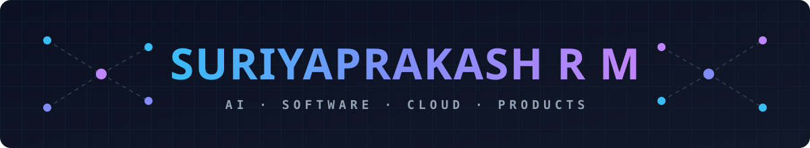

<!-- ═══════════════════════════════ HERO ═══════════════════════════════ -->

  

<!-- 📸 PHOTO: save a square photo as profile/avatar.png (ideally pre-cropped to a circle
     with a transparent background), then change the src below to ./profile/avatar.png -->

### Hi, I'm Suriyaprakash 👋

**AI & software engineer · B.Tech Artificial Intelligence & Data Science**

  
  
  
  

&nbsp;

<!-- ═══════════════════════════════ ABOUT ═══════════════════════════════ -->

## About me

I build at the intersection of **AI, software engineering, data and product**. My approach: pick a real problem, prototype quickly, break it on purpose, find out why it broke, and ship something people can use.

- 🔭 **Building:** [AgentShelf](https://github.com/suriyaprakash-25/AgentShelf), an MCP storefront that AI shopping agents can search and buy from, and [BoreSakshi](https://github.com/suriyaprakash-25/BoreSakshi), which predicts borewell success for farmers
- 🧠 **Focus:** ML engineering, LLM agents (MCP, LangGraph), explainable AI, full-stack systems
- 🌱 **Learning:** distributed systems, system design at scale, MLOps
- 🏆 **Recent:** PayPal Mentorship Program · InnoHack (VIT) finalist · three 2nd-place wins in 2025
- 💬 **Ask me about:** shipping ML to production, Python/FastAPI backends, React frontends
- 📫 **Reach me:** [suriyaprakashrm25@gmail.com](mailto:suriyaprakashrm25@gmail.com). I'm open to internships, collaborations and interesting problems

<!-- ═══════════════════════════════ WORK ═══════════════════════════════ -->

## Featured work

<table>
<tr>
<td width="50%" valign="top">

### 🛍️ [AgentShelf](https://github.com/suriyaprakash-25/AgentShelf)
**Made by you. Found by AI.**

Turns WhatsApp product photos and voice notes from independent sellers into an **AI-discoverable MCP storefront**, with server-verified quotes and human-approved PayPal checkout.

- MCP server exposing catalog search, quotes, checkout and order status
- Vision-drafted listings that the seller confirms, plus schema.org storefronts
- PayPal Orders v2 integration with webhook verification

`FastAPI` `PostgreSQL` `MCP` `PayPal` `React`

</td>
<td width="50%" valign="top">

### 💧 [BoreSakshi](https://github.com/suriyaprakash-25/BoreSakshi)
**Know before you drill.**

A verified-outcome network and AI prediction engine that tells rural households **where a borewell is likely to succeed, how deep to drill and what yield to expect**, before they spend lakhs.

- Success, depth and yield models with calibration and **conformal uncertainty**
- Geospatial feature extraction and human-approved model deployment
- Separate farmer, rig-operator and admin interfaces

`Node` `MongoDB` `FastAPI` `scikit-learn` `Leaflet`

[**Live demo →**](https://boresakshi.vercel.app)

</td>
</tr>
<tr>
<td width="50%" valign="top">

### 🩺 [SepsisSense](https://github.com/suriyaprakash-25/SepsisSense)
**Early sepsis detection for ICU patients.**

An end-to-end ML pipeline on the **PhysioNet 2019** dataset that predicts sepsis onset and explains every prediction.

- Clinical feature engineering: rolling vitals, Shock Index, qSOFA and lab trends
- GPU-trained XGBoost/LightGBM with patient-level temporal splits
- **SHAP** per-patient explanations in a Streamlit dashboard

`Python` `XGBoost` `SHAP` `Streamlit`

</td>
<td width="50%" valign="top">

### 🎯 [Redrob Ranker](https://github.com/suriyaprakash-25/redrob-ranker)
**Hackathon candidate-ranking engine.**

A multi-stage pipeline that ranks the top 100 candidates out of **100,000 in about 64 seconds on a CPU, with zero LLM calls**.

- Honeypot detection, structured JD-fit scoring, TF-IDF/SVD semantic match
- Trust and availability modifiers, deterministic reasoning
- LLM re-ranking was tested and rejected: it would take 2.8–55 hours against a 300-second budget

`Python` `scikit-learn` `NLP` `Hugging Face`

[**Live demo →**](https://huggingface.co/spaces/Suriya-25/redrob-ranker)

</td>
</tr>
<tr>
<td width="50%" valign="top">

### 🛡️ [AutoShield Edge AI](https://github.com/suriyaprakash-25/AutoShield-Edge-AI)
**CAN-bus intrusion detection for vehicles.**

A gateway-oriented automotive cybersecurity proof of concept that combines rules and ML specialists to catch attacks on in-vehicle networks.

- Detects DoS, fuzzing, RPM spoofing and gear spoofing
- Per-ID rate policy, CAN-ID allowlist and logistic-regression specialists
- Live dashboard with an animated vehicle digital twin

`Python` `ML` `Embedded/Edge` `Cybersecurity`

</td>
<td width="50%" valign="top">

### 📊 [AskMetrics](https://github.com/suriyaprakash-25/AskMetrics)
**Ask your database in plain English.**

Natural-language analytics over a commerce database, powered by a **local LLM (Qwen3 8B via Ollama)** with strict safety guarantees.

- Schema-aware prompting with business-semantic hints
- AST-checked SQL validation that allows a single read-only statement
- Bounded, time-limited execution against a sandboxed database

`FastAPI` `React` `TypeScript` `Ollama` `SQL`

</td>
</tr>
</table>

<b>More projects →</b>

 

| Project | What it is | Stack | Links |
|---|---|---|---|
| **DrivePortz (Digital Twin)** | Full-stack digital twin of real-world vehicles | JavaScript · Node · React | [Code](https://github.com/suriyaprakash-25/Digital-Twin) · [Live](https://www.driveportz.com/) |
| **MedFlow Guardian** | Patient-controlled medical records with time-limited, auditable access sharing between hospitals | FastAPI · PostgreSQL · React · FHIR | [Code](https://github.com/suriyaprakash-25/medflow-guardian) |
| **CounterGuard** | Multi-agent counterfeit and grey-market investigation that scores marketplace listings for risk | FastAPI · LangGraph · Scraping | [Code](https://github.com/suriyaprakash-25/counterguard-ai) |
| **STATUTEK** | Compliance and legal-tech startup platform | React · Tailwind · Framer Motion | [Code](https://github.com/suriyaprakash-25/STATUTEK) · [Live](https://statutek.vercel.app/) |
| **CrowdFundX** | Crowdfunding web platform | JavaScript | [Code](https://github.com/suriyaprakash-25/CrowdFundX) · [Live](https://crowd-fund-x-psi.vercel.app/) |
| **KnowledgeNest** | Knowledge-sharing platform | JavaScript | [Code](https://github.com/suriyaprakash-25/knowledgenest) · [Live](https://knowledgenest-nine.vercel.app) |

<!-- ═══════════════════════════════ STACK ═══════════════════════════════ -->

## Tech stack

<table>
<tr><td><b>Languages</b></td><td></td></tr>
<tr><td><b>AI / ML</b></td><td>  XGBoost · LightGBM · SHAP · Keras · Pandas · NumPy · LangGraph · MCP · Ollama</td></tr>
<tr><td><b>Backend</b></td><td></td></tr>
<tr><td><b>Frontend</b></td><td></td></tr>
<tr><td><b>Data</b></td><td></td></tr>
<tr><td><b>Cloud / DevOps</b></td><td></td></tr>
</table>

<!-- ═══════════════════════════════ ACHIEVEMENTS ═══════════════════════════════ -->

## Achievements

| | |
|---|---|
| 🏢 **PayPal Mentorship Program** | Selected for industry mentorship in real-world software engineering |
| ✈️ **Fly to Singapore 12.0 qualifier (RYLA 54.0)** | Selected on entrepreneurship, business planning and leadership |
| 🏁 **Finalist, InnoHack (VIT University)** | National-level hackathon |
| 🥈 **2nd Prize, Creatathon 2025** | |
| 🥈 **2nd Prize, Freshathon 2025** | |
| 🥈 **2nd Prize, Web Design Showdown 2025** | |

<!-- ═══════════════════════════════ GITHUB ═══════════════════════════════ -->

## GitHub activity

<!-- ═══════════════════════════════ CONTACT ═══════════════════════════════ -->

## Let's build something

I'm always up for an interesting problem, a collaboration or a conversation about AI and products.

<code>Curiosity → Experiment → Build → Break → Learn → Ship</code>

